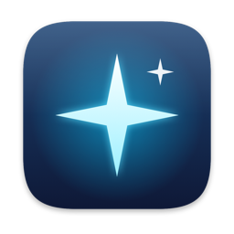
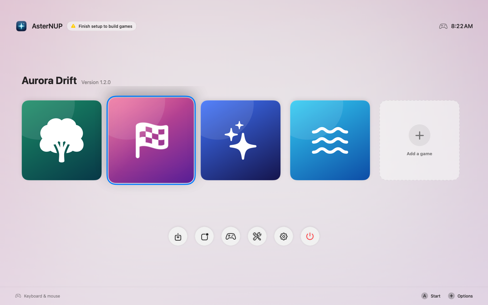
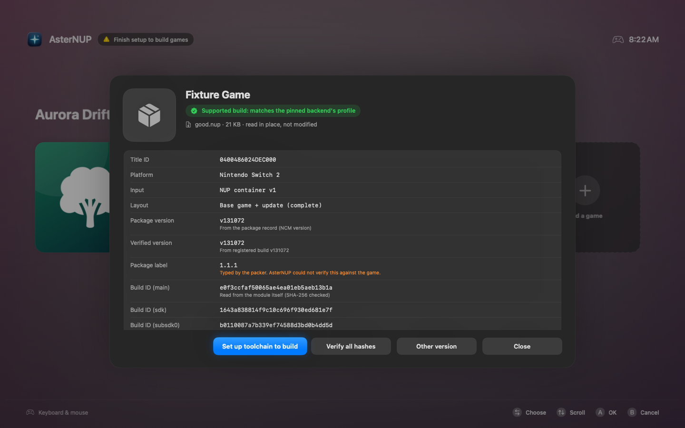
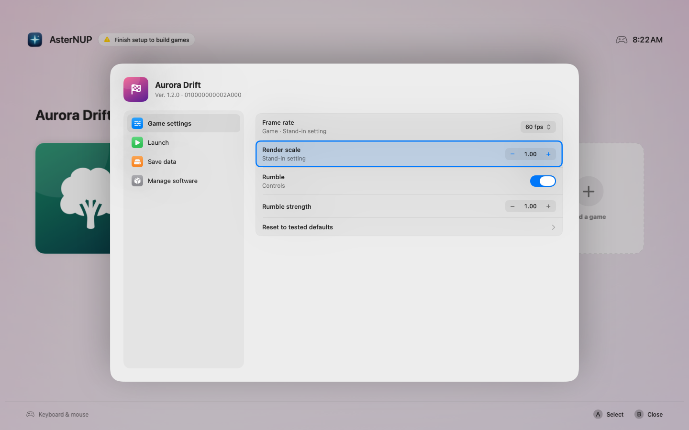

<div align="center">



# AsterNUP

**A controller-first game library for Apple silicon Macs.**<br>
Bring a dump of a game you own, build it into a native Mac app, and play it from a Home screen made for the couch.

[](#requirements)
[](#requirements)
[](CONTRIBUTING.md)
[](LICENSE)

[Install](#install) · [Getting started](docs/GETTING_STARTED.md) · [Controls](#controls) · [Docs](#documentation) · [Acknowledgements](ACKNOWLEDGEMENTS.md)

<picture>
  <source media="(prefers-color-scheme: dark)" srcset="docs/images/home-dark.png">
  
</picture>

</div>

## What it is

AsterNUP is a Mac front end for [nxnative](https://github.com/seedds/nxnative), which turns a game dump into a native
Apple silicon app. AsterNUP handles everything around that: it checks your dump before anything is built, runs the
build with real progress, installs the result, and gives you a full-screen library you can drive entirely with a
controller, including a HOME button that takes you back without closing the game.

- **Import in place.** Drop in a `.nup` or an ExeFS/RomFS folder. It's read where it is and never modified.
- **Know what you have.** The report shows title ID, platform, versions, the build IDs read from the code itself, and
  whether the pinned backend supports that exact build. If something's wrong, it tells you the next step.
- **Build safely.** Disk check, real progress and time left, cancel at any point, then validation and a swap that keeps
  your previous app until the new one is in place.
- **Play like a console.** Start, press HOME to come back while the game keeps running, resume the same session, close
  with confirmation. A pre-launch check catches memory hogs, Low Power Mode and a hot Mac.
- **Per-game settings and saves.** Each game's own options (frame rate, resolution, display mode…) with tested
  defaults, and verified ZIP backups of its saves.
- **Controllers you already have.** Switch Pro Controller, Joy-Con, Xbox, PlayStation and MFi controllers, gamepads
  macOS doesn't list (raw HID), and Switch 2 controllers inside games. Keyboard and mouse work everywhere too.
- **A Mac app, not a port.** Your accent colour, Light and Dark Mode, materials, SF Symbols, standard menus, ⌘O to
  import, ⌘, for settings.

> [!IMPORTANT]
> AsterNUP works only with games you own and dump yourself. It doesn't download, include or link to games, keys,
> firmware or updates, and it isn't affiliated with Nintendo or any game publisher.

## Requirements

| To | You need |
|---|---|
| Run AsterNUP | A Mac with Apple silicon (M1 or later), macOS 14 Sonoma or later |
| Build games | macOS 26.6 or later, Xcode 27.2 with its Metal toolchain, [Homebrew](https://brew.sh), free disk space of about twice the game's size plus 10 GB |
| Play smoothly | 16 GB of memory or more ([details](docs/PERFORMANCE.md)) |

The game-build requirements come from the [pinned nxnative version](Resources/Backend/pins.json). AsterNUP checks all
of them for you and shows the fix for anything missing.

## Install

Open Terminal and paste:

```bash
curl -fsSL https://raw.githubusercontent.com/asterpolaris/AsterNUP/main/scripts/install.sh | zsh
```

That builds AsterNUP from source, installs it to `~/Applications`, installs the Homebrew tools and Python modules the
backend needs, fetches the pinned backend, checks the game-build toolchain and opens the app. It prints anything left
for you to do (usually: install Xcode). Run the same command again to update. Options go after `zsh -s --`, for
example `… | zsh -s -- --no-deps` to skip the Homebrew and Python setup.

<details>
<summary><b>Other ways to install</b></summary>

**Disk image.** Download `AsterNUP-<version>.dmg` from [Releases](https://github.com/asterpolaris/AsterNUP/releases),
drag AsterNUP to Applications and open it. Builds there aren't notarized yet, so the first time, go to System Settings ›
Privacy & Security and click **Open Anyway**. Then open **Backend & toolchain** in AsterNUP and choose **Set up
backend** and **Set up Python environment**.

**From a clone.**

```bash
git clone https://github.com/asterpolaris/AsterNUP.git
cd AsterNUP
make install
```

**In Xcode.** Open `AsterNUP.xcodeproj` and run the **AsterNUP** scheme. See [Building](docs/BUILDING.md).

</details>

To remove AsterNUP, run `scripts/uninstall.sh` from the source folder (the one-line installer keeps it in
`~/Library/Application Support/AsterNUP/Source`). Add `--all` to remove its library and build folders too. Your games,
saves and backups are never touched.

## Quick start

1. **Install Xcode 27.2** from [developer.apple.com](https://developer.apple.com/download/), then in Terminal:
   `sudo xcode-select -s /Applications/Xcode.app` and `xcodebuild -downloadComponent MetalToolchain`.
2. **Check the toolchain** in AsterNUP: **Backend & toolchain** in the dock. Every item should be green.
3. **Dump your game with its update** into one `.nup` and copy it to your Mac.
4. **Import it**: **Import a dump** in the dock (⌘O), or drop the file on the window. Read the report.
5. **Build & install.** The first build takes 30–60 minutes. Then pick the tile and press A.

The full walk-through, with what each report verdict means, is in [Getting started](docs/GETTING_STARTED.md).

## Controls

| Action | Controller | Keyboard and mouse |
|---|---|---|
| Move | D-pad or left stick | Arrow keys |
| Start, resume, OK | A (the button labelled A; right on Nintendo pads) | Return or Space, click |
| Back, cancel | B | Esc |
| Game options | + (or Y) | O, or Control-click › Options |
| Close a running game | X on a Playing tile | X, or Control-click › Close Software |
| Games ↔ dock | L / R | Tab / Shift-Tab |
| Back to AsterNUP while playing | HOME (short press), or − and + together | ⌃⌥H (configurable) |
| Full screen | — | ⌃⌘F |

More in [Controllers](docs/CONTROLLERS.md), including Switch 2 controllers and how HOME works.

## Screenshots

<table>
  <tr>
    <td width="50%"></td>
    <td width="50%"></td>
  </tr>
  <tr>
    <td align="center"><sub>The import report: what the dump is and whether it can be built</sub></td>
    <td align="center"><sub>Per-game options, with the game's own tested defaults</sub></td>
  </tr>
</table>

<sub>Screenshots use stand-in apps with placeholder artwork.</sub>

## Documentation

| Guide | What's in it |
|---|---|
| [Getting started](docs/GETTING_STARTED.md) | From nothing to playing, step by step |
| [Adding games](docs/ADDING_GAMES.md) | Import, the report, building, existing apps, per-game options, your next game |
| [Controllers](docs/CONTROLLERS.md) | Nintendo and other controllers, button layout, HOME |
| [Smoothest play](docs/PERFORMANCE.md) | What decides the frame rate, and what helps |
| [Troubleshooting](docs/TROUBLESHOOTING.md) | Fixes for common problems, and how to report a bug |
| [Building](docs/BUILDING.md) | Building AsterNUP, signing, notarization, `make` targets, releases |
| [Architecture](docs/ARCHITECTURE.md) | How the pieces fit, the backend interface, where data lives |

## FAQ

**Does AsterNUP emulate games?**
No. [nxnative](https://github.com/seedds/nxnative) builds each game into a native Mac app; AsterNUP is the library,
build manager and launcher around it. Compatibility and in-game issues belong in
[nxnative's issues](https://github.com/seedds/nxnative/issues).

**Which games work?**
The ones the pinned nxnative version has profiles for. **Backend & toolchain › Supported games** lists them, with the
exact builds each one was tested with. The import report tells you whether your dump matches.

**Can I share the apps it builds?**
No. They're ad-hoc signed for your Mac and contain the game you dumped. They can't be notarized as built, and the game
is yours, not something to distribute.

**Where are my saves?**
In `~/Library/Application Support/nxnative/<title ID>/save`. **Options › Save data** opens the folder or makes a
verified ZIP backup. Rebuilding, removing a game or uninstalling AsterNUP never touches them.

**Why does it need Xcode?**
nxnative compiles each game's shaders for Metal and packs a real app bundle, which needs Apple's compilers. AsterNUP
itself only needs the Command Line Tools.

## Contributing

Bug reports, fixes and controller test results are welcome. Read [Contributing](CONTRIBUTING.md) first: it covers
building, the automated checks (`make test`, no dump needed), and what must never be committed or attached to an
issue. Security issues: see [Security](SECURITY.md).

## Acknowledgements

AsterNUP stands on [nxnative](https://github.com/seedds/nxnative) by seedds and its contributors, who do the hard part.
It also relies on the NUP container format, XcodeGen, Homebrew and several open-source Python packages, and borrows
ideas from OpenEmu, Whisky and Apple TV. The full list, with licenses, is in [Acknowledgements](ACKNOWLEDGEMENTS.md).

## License

AsterNUP is released under the [MIT License](LICENSE). Third-party projects keep their own licenses
([details](ACKNOWLEDGEMENTS.md#third-party-notices)).

Nintendo Switch, Joy-Con and related names are trademarks of Nintendo. Apple, Mac, macOS, Xcode and Metal are
trademarks of Apple Inc. AsterNUP is not affiliated with, endorsed or sponsored by Nintendo, Apple or any game
publisher.
